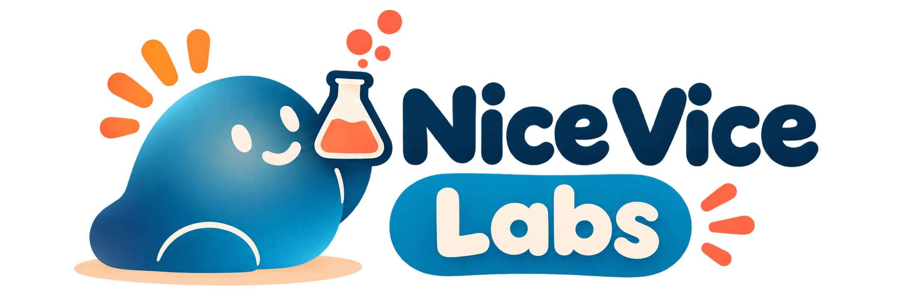

  

<h1 align="center">Nice Vice Labs</h1>

<strong>A software studio that turns ideas into working prototypes.</strong>

## What We Do

We build early versions of software that people can run and test. Each prototype helps us see whether an idea solves the problem and decide what to build next.

## How We Work

- Define the problem and scope before writing code.
- Write code that is easy to read and review.
- Document how to run each project and where its limitations lie.

## Repositories

Explore the **Repositories** tab to browse our code. Each project's README explains what it does and how to get it running.
